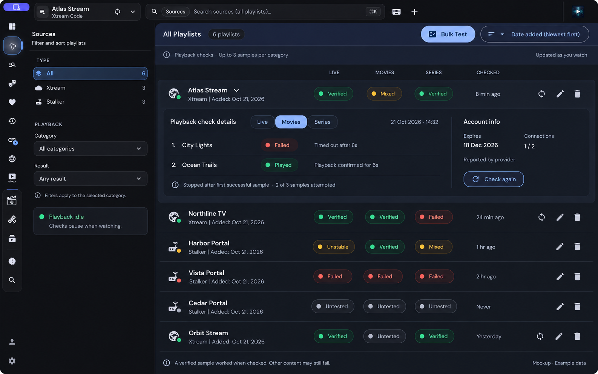

# Source playback verification

Date: 21 October 2026

Status: design ready for review; application implementation has not started.

## Goal and approved direction

Help a viewer find sources with recent evidence of playable Live, Movies, and
Series content. A successful sample proves only that item worked at that time
with the recorded engine. It never guarantees the whole library works.

The user approved the source-aware visual direction and staged workflow. This
is an architectural feature: it spans playlist UI, provider resolution, player
ownership, evidence persistence, and scheduling. Deliver it in vertical slices,
starting with desktop Xtream Live.

The image uses fictional data. Preserve its navigation, search, filters, row
actions, category results, and inline details structure. Its displayed timings
illustrate the interaction; the policy values below govern implementation.

## Existing code and integration constraints

These paths were located through graphify and inspected in the working tree:

| Existing surface | Integration consequence |
| --- | --- |
| `libs/workspace/shell/feature/src/lib/workspace-shell/` | Keep the narrow icon rail, global scoped search, playlist switcher, and existing shell. |
| `libs/workspace/shell/feature/src/lib/workspace-sources/` | Keep All Playlists, count, Bulk Test, and existing sort choices. Bulk Test remains the credential-testing tool. |
| `libs/workspace/shell/feature/src/lib/workspace-sources-filters-panel/` | Extend the current All/Xtream/Stalker sidebar with category and playback-result filters. |
| `libs/providers/shared/playlist-ui/src/lib/recent-playlists/` | Extend existing rows; preserve source navigation, custom drag ordering, refresh, edit, delete, busy states, and sidebar mode. |
| `apps/desktop-ui/src/m3-theme.scss` | Use existing graphite surfaces, blue selection tokens, and DM Sans. |
| `libs/services/src/lib/portal-status.service.ts` | Its account/genre requests and 30-second cache describe portal status, not successful playback. Retain that distinction. |
| `libs/providers/shared/playlist-ui/src/lib/recent-playlists/playlist-info/user-agent-test-runner.ts` | Reuse cancellation/cleanup design, not its definition of success: recognizable media is insufficient playback evidence. |
| `libs/providers/shared/playlist-ui/src/lib/recent-playlists/playlist-info/playlist-user-agent-test.service.ts` | Existing tester is desktop Stalker Live and tries at most two samples per user-agent profile. This is not the proposed three-category checker. |
| `libs/player/ui/src/lib/player-controls/player-controls.model.ts` | Runtime telemetry exposes presented frames, native frame readiness, audio-only identification, time, seeking, and stalled state. |
| `libs/player/ui/src/lib/workspace-player/workspace-player-state.service.ts` | Observe confirmed runtime snapshots and request generations; do not use raw timeupdate or replace foreground player state for background checks. |
| `libs/providers/xtream/data-access/src/lib/services/xtream-api.service.ts` | Reuse account and catalogue APIs with request/session cancellation. |
| `libs/providers/xtream/data-access/src/lib/account-info/account-info.interface.ts` | Expiry, active connections, and maximum connections are provider-reported fields. |
| `libs/services/src/lib/playlists.service.ts`, `libs/database/src/lib/schema.ts` | Desktop playlists use SQLite, with an IndexedDB migration path. Store evidence separately from playlist payloads. |

The running desktop Sources page was inspected as well. The workspace contains
pre-existing, uncommitted player changes; preserve them. Recheck the current
runtime contracts before implementation rather than overwriting those changes.

## Approach and boundaries

Three approaches were considered:

1. Extend portal-status or media-signature probes. Cheap, but cannot establish
   the promised playback result; rejected as the badge's evidence source.
2. Record only normal viewing. Strong evidence with no extra connections, but
   leaves unused sources untested; include this as a complementary input.
3. Use a dedicated silent playback session while idle, plus normal-viewing
   evidence. Selected: it meets the discovery goal while preserving truthful
   results and foreground ownership.

Separate responsibilities:

- **Evidence model/reducer:** pure result classification, freshness, precedence,
  history bounds, and filter matching. No network or Angular dependencies.
- **Evidence repository:** batched summary reads and atomic bounded history writes.
- **Provider sampler:** enumerate eligible items and resolve fresh playback links
  through Xtream or Stalker paths. Returns identities, not persisted signed URLs.
- **Playback probe:** own an isolated muted player and resources; emit actual
  playback evidence or a typed outcome; support awaited cancellation.
- **Scheduler:** enforce idle ownership, fairness, deadlines, and cooldowns.
- **Viewing observer:** turn confirmed foreground playback into matching evidence.
- **UI:** display repository snapshots and request checks without implementing
  classification or transport policy inside playlist row components.

The background probe must not open a visible player, launch external apps,
switch the active playlist, change volume, record viewing history, set resume
positions, or trigger foreground recovery dialogs. Initially support the
in-app browser media path with the existing preparation/proxy helpers. Record
that engine explicitly. If that path cannot supply genuine playback evidence,
report an inconclusive/unsupported-engine attempt; never fall back to awarding
Verified from a signature probe. Expanding silent checks to native engines is
outside the first milestone.

## Result semantics

Every source has independent `live`, `movies`, and `series` evidence. Keep
classification separate from activity (`queued`, `checking`, `deferred`) and
freshness (`fresh`, `stale`).

| Result | Rule |
| --- | --- |
| Untested | No conclusive completed check or qualified viewing event for this source revision and category. |
| Verified | Latest conclusive observation succeeded with no failed samples in that check. |
| Mixed | Latest conclusive check contains both failed sample attempts and a successful sample. |
| Failed | A completed check exhausted its eligible attempts with failures and no success, or the latest qualified viewing attempt ended in a classified playback failure. |
| Unstable | At least three conclusive observations in the last seven days contain at least two switches between playable and failed results. This takes precedence over the latest check's base result. |

For instability, Verified and Mixed both count as playable, and only one
observation per completed check/viewing attempt is counted. Inconclusive and
cancelled attempts do not count. Show the latest check's base outcome in details
even when Unstable is the displayed result. Recompute the window as time passes.

Mixed is order-dependent under early stopping; show sample counts, order, and
the exact attempts rather than representing it as a library success percentage.

Evidence becomes stale after 24 hours; retain its result with a Stale label and
timestamp. Keep `lastSuccessfulAt` even after a later failure. Offline device,
user cancellation, local engine unavailability, local browser access limits,
unknown connection capacity, provider throttling, and interrupted checks must
not fabricate a Failed result. They may leave an attempt note while preserving
the previous conclusive result. No available catalogue items means Untested
with an explanation, not Failed.

A check is conclusively Failed only when all available selected candidates
(up to three) were attempted and each produced a classified failure. If a
category deadline, cancellation, or inconclusive candidate prevents that, save
the partial attempt details and retain the previous conclusive result. A
qualified success can conclude Verified/Mixed immediately despite an earlier
inconclusive attempt; inconclusive attempts do not count as failed samples.

Failure details distinguish provider rejection, unavailable item/link,
startup deadline, stalled playback, unsupported media, and local/network
uncertainty. Engine-specific unsupported media is described as such, without
claiming the source fails on every player. Only attribute a failure to the
provider when diagnostics support it. A device-wide outage is inconclusive.

## Playback success and sampling

For a video sample require confirmed `playing`, non-seeking, non-stalled
runtime observations spanning six seconds of forward media-clock progress,
plus evidence that video frames were actually presented/decoded. Reset the
success window on stall, seek, engine replacement, or sample generation change.
`playing`, an HTTP success, loaded metadata, or a nonempty response alone does
not qualify. For positively identified audio-only content require the same
clock-progress window and engine-confirmed audio playback; label it audio-only.

Try at most three distinct items per category. Stop immediately after the first
qualified success. Resolve fresh provider URLs for each attempt and release the
previous attempt before the next. Prefer a recent successful eligible item, then
rotate across distinct available categories/items using a persisted cursor.
Respect hidden categories. Never unhide content or import a whole catalogue just
to populate samples. If fewer than three candidates exist, try only those
candidates and display the actual count. Series checks resolve a real episode.

Proposed initial deadlines, centralized and injectable for tests:

- Catalogue/sample discovery: 10 seconds per category, including link selection.
- Each sample: 20 seconds total for fresh link resolution, preparation, startup,
  and the six-second success window. Existing provider deadlines remain bounded
  by this parent deadline.
- Category: 70 seconds overall, including discovery and up to three samples.
- Cleanup: cancellation and resource release must finish before another check
  starts. After two seconds without acknowledgement, mark teardown pending and
  suspend background checks until the owner confirms closure. Do not overlap
  connections to work around uncertain cleanup.

## Scheduling and playback ownership

Desktop-only automatic checks start after ten seconds of genuine playback idle
time. Paused, loading, buffering, mini-player, picture-in-picture, native,
external, YouTube, pending playback opens, and recovery sessions all count as
occupied. An unknown external player's lifetime blocks checks until the app
knows it has ended. Route changes alone do not establish idle.

Use one app-wide playback-resource coordinator shared by foreground opens and
background probes. Acquire the background lease before provider work. A user
play request immediately revokes it and awaits confirmed cleanup at the existing
foreground transition boundary. It must not wait for the sample/category
deadline; after the two-second cleanup limit it enters the foreground's existing
teardown-failure path rather than starting an overlapping connection. Subsequent
checks remain suspended until cleanup is confirmed. Timer cancellation alone
does not prove a connection has been closed.

Run one background attempt globally. Queue fairly by source and category so a
slow provider cannot block the rest for more than the category deadline. After
a completed check do not automatically recheck that category for 24 hours.
Timeout/unavailable-provider cooldown starts at 15 minutes, doubles per
consecutive inconclusive check, and caps at six hours. Reset it on success.
Honor a longer provider Retry-After. Manual Check again bypasses freshness but
not idle ownership, active provider throttling, or uncertain cleanup. Coalesce
duplicate requests by source revision/category.

When account data reports all connections in use, defer until a later attempt;
do not mark failure. Unknown usage is shown as unknown and does not itself
prohibit a check while the app is idle. Account lookup must have its own bounded
deadline and cannot consume a playback sample. Never run checks during source
refresh/delete/import operations; invalidate queued work when these begin.

## Persistence, identity, and account information

Use additive SQLite evidence tables accessed through the existing database
worker/typed IPC boundary. Keep evidence keyed by source ID, opaque source
revision, and category. The revision changes when credentials, endpoint, device
identity, or effective playback headers change; a rename does not invalidate
evidence. Use a random opaque revision, not a plaintext credential-derived key.
Reject late writes with mismatched revision or deleted source IDs.

Persist:

- Latest conclusive result and observation time, last success time, and freshness.
- Up to 20 observations per source/category, removing entries older than 30 days.
- Up to three ordered samples for each automatic/manual check: catalogue item ID,
  safe display title, outcome, safe reason code, elapsed time, and engine.
- Origin (`background`, `manual`, `viewing`), check ID, and sample-selection cursor.
- A separate latest attempt note for cancellations/deferred/inconclusive checks.

Never persist resolved media URLs, signed links, auth headers, tokens, passwords,
or unredacted transport errors in this feature's records. Sanitize display titles
and reason text. A failed save must not appear as a saved result; keep a visible
retryable persistence error. Commit each observation atomically and publish
updated summaries only after acknowledgement. Retrieve source summaries in one
batch rather than issuing a database request for each row.

Delete evidence when deleting a source. Copying/importing credentials does not
copy verification evidence. This release does not add evidence to backups or
sync. Browser-only installations show this feature as unavailable rather than
silently substituting localStorage for desktop persistence.

Account expiry/usage are separate provider-reported snapshots, with retrieval
time and nullable values. Reuse existing Xtream account actions and Stalker
account profile handling. Missing fields show Not reported. No expiry date is
inferred from zero or malformed input; only explicit provider semantics may
produce No expiry. A failed account fetch does not erase prior playback evidence.

## UI and normal viewing

Keep the approved mockup's shell and source filters. Show three compact labelled
results and a Checked age. On narrow widths wrap results beneath the title and
keep actions reachable; do not squeeze the list into unreadable columns. Leave
the compact playlist-switcher/sidebar row variant unchanged.

Use a dedicated labelled disclosure button to open inline history, with
keyboard operation and `aria-expanded`. Clicking the source body still navigates
into its content. Clicking results may open that category's evidence; it must
stop propagation. Preserve custom ordering and disable drag for interactive
expanded content. Status uses text and an icon as well as color.

Details show checked time, engine, origin, ordered samples, safe failure reasons,
last success, freshness, account data, and Check again. Portal status remains
independent, with an explicit tooltip so its existing small dot cannot imply
playback success. Keep the sample limitation visible beneath the list.

Category defaults to All categories and result defaults to Any result. When All
categories is selected, a result filter matches if any category has that result;
with a specific category selected, match only that category. Working recently
means fresh Verified or Mixed evidence in the selected category (any category
when All is selected); Unstable is excluded. Add this as an explicit quick filter.
Keep the current source-name search and sort semantics; custom sort preserves
saved order among matching rows.

For normal viewing, subscribe once at the shared confirmed-runtime boundary and
associate events with the current source revision, resolved item, category,
engine, and attempt generation. Require the same qualified success window. Save
at most one success per attempt; a later terminal failure in that same attempt
updates that observation, preserving its success time and recording degradation
without adding a second instability observation. Ordinary stop/pause/seek and
cancelled engine fallback are not failures. Only the final failure after automatic
recovery is exhausted is conclusive. Ignore callbacks from superseded attempts.
External launches lacking confirmation remain unverified. Background attempts
never enter normal-viewing observers or history.

## Delivery and verification

1. **UI and model:** implement classification/freshness and the approved list,
   filters, and expansion against test fixtures. Fixtures stay in development
   stories/tests; no fabricated results appear in real saved sources.
2. **First complete milestone:** desktop Xtream Live manual check, silent real
   playback confirmation, persisted evidence, reopening and displaying it.
3. **Background operation:** idle/resource coordinator, cancellation, fair queue,
   deadlines, cooldowns, and teardown fault handling.
4. **Coverage:** Xtream Movies and Series episodes, then Stalker categories and
   provider-reported account data. No badge is fabricated for incomplete adapters.
5. **Normal viewing:** shared-runtime observer, conflict handling, fresh-working
   filters, and production enablement after regression checks.

Meaningful tests must cover success from actual telemetry rather than metadata,
first-success stopping, fewer-than-three candidates, timeout fairness, stalled
playback, foreground preemption during every stage, awaited resource release,
late successful preparation cleanup, stale-generation writes, source edits and
deletion, mixed/unstable precedence, clock-controlled freshness, migrations and
restart persistence, missing account fields, and prevention of history pollution.

Run focused suites for touched libraries and IPC/database operations, relevant
existing playback lifecycle tests, type/lint checks and desktop build. Visually
inspect the actual Sources page at normal and narrow widths, preserving existing
row navigation/actions and custom ordering. Use fake transports for automated
tests and live sources only for intentional acceptance checks. Run
`graphify update .` after application-code changes.

First-milestone acceptance: a real saved Xtream source obtains a truthful Live
result with ordered evidence, releases its connection, survives application
restart, and cannot interfere with an immediate user playback request. Full
feature completion also requires both providers, all three categories, normal
viewing updates, filters, freshness, account display, and the regression checks.

## Review boundary

This spec records concrete proposed policy choices: six seconds of confirmed
playback, 24-hour freshness, conservative idle ownership, bounded history, and
engine-scoped evidence. Review this written design before the implementation
plan. No application code is changed by this document.
