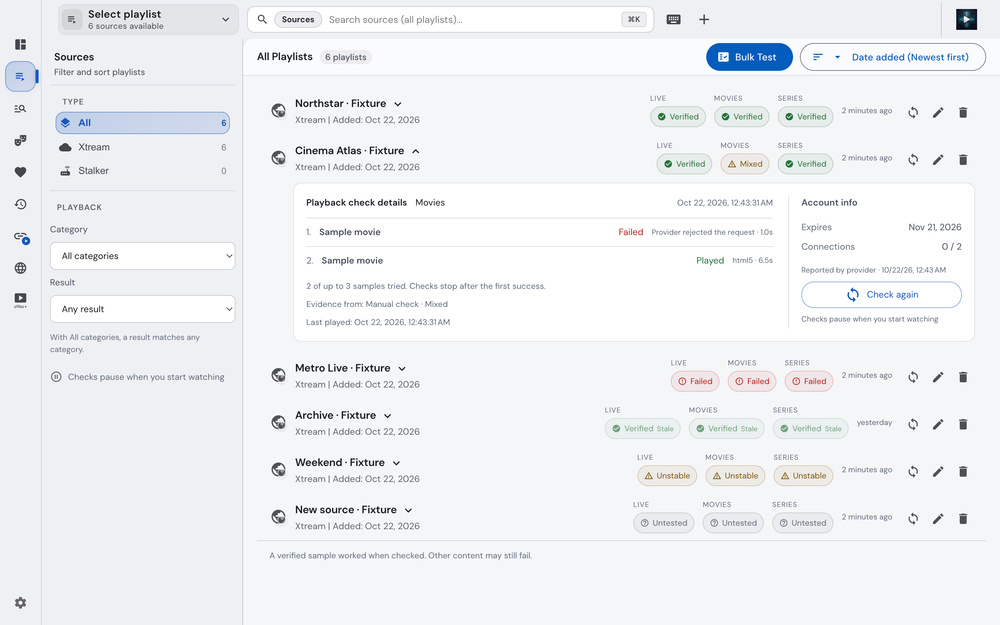
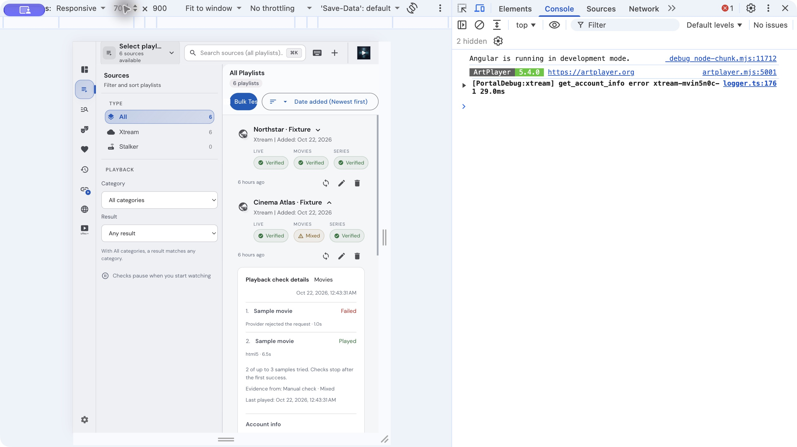

# Source playback verification acceptance

Implemented on `codex/source-playback-verification` in the isolated native worktree. Existing uncommitted playback work was preserved separately from feature commits.

## Acceptance evidence

- Node regression runner: **750/750 passed** (`node tools/testing/run-node-tests.mjs`).
- Angular regression runner: **58 suites, 717 tests passed** (`node tools/testing/run-angular-tests.mjs`).
- Actual Electron decoder fixture: all six Xtream/Stalker Live/Movie/Series samples played with at least148 presented frames; metadata-only media remained unverified. Command: `ARM_NATOR_FFMPEG=<existing native ffmpeg> ./node_modules/.bin/electron tools/testing/source-playback-probe.electron.cjs`.
- Desktop and backend `tsc --noEmit` passed with their respective `tsconfig.app.json` files.
- Changed-source ESLint: zero errors; warnings remain for existing file sizes and test typing/non-null assertions.
- Worker build and both application targets passed. Native runtime prerequisites were reused from the existing workspace because no native source changed: `node apps/electron-backend/build-worker.js`, `NX_DAEMON=false ./node_modules/.bin/nx run electron-backend:build --excludeTaskDependencies --outputStyle=static`, and `NX_DAEMON=false ./node_modules/.bin/nx run desktop-ui:build --configuration=development --baseHref=./ --excludeTaskDependencies --outputStyle=static`.
- `graphify update .` rebuilt the locally ignored graph; `git diff --check` passed.

## Native visual inspection

Used a dedicated Electron test profile with six fabricated sources and loopback endpoints; the user's running installed application and accounts were not used. Inspected1440px and700px viewports alongside the approved mockup. The implementation uses the existing app theme and shell, with per-category pills, inline samples, account facts, checked ages, stale/untested states, result filtering, scoped search and keyboard focus. The Mixed filter showed one matching source; an unmatched scoped query showed zero. Existing navigation and Bulk Test remain available. Manual check activity disables the check button. The full native Live path changed an Untested category to Verified after6.5s, with the real app IPC/SQLite repository and provider-reported expiry and0/2 connections.

An unavailable fixture check preserved the prior Mixed observation and last success. The native test found that a zero-sample retry hid earlier samples; a failing UI regression reproduced this and the repaired detail panel keeps the saved samples while showing the newer inconclusive reason and time.

## Scope and limitations

The first milestone has real SQLite/runner integration, actual Xtream Live decoding and native UI acceptance. Full-feature acceptance adds six provider/category decoder fixtures, account mappings, revision/edit/delete lifecycle, scheduler/ownership, cancellation/late cleanup and normal-viewing observation tests. Real saved providers were not swept; provider-specific live interoperability remains dependent on their media and authentication behavior.

DASH is an inconclusive unsupported silent-engine result. Native audio-only viewing without positive decoded-audio telemetry cannot verify a sample. External sessions with unknown process lifetime conservatively block automatic checks. Native runtime compilation/release packaging was not repeated. No merge, push, deployment or release is included.

## Execution rulings

- Ruling: native managed worktree includes copied working changes without committing them — the plan requires current playback contracts and preserving user work — risk: future commits must stage only feature changes.
- Task 2: Ruling: database triggers rotate revisions/cascade evidence atomically rather than adding hooks to each existing playlist writer — covers direct edits, full upserts and future write paths without changing their behavior — risk: durable identity fields added later must be included in the trigger.
- Task 2: Ruling: reuse installed tools directly via node_modules/.bin in linked worktree because pnpm exec rejects linked install layout — no dependency versions changed — risk: aggregate commands need the same direct executable invocation.
- Task 3: Ruling: screenshot comparison deferred to integrated Electron fixture host in Tasks5/11 — standalone Sources cannot exercise desktop evidence IPC with the production database safely — risk: visual differences may require later correction; build and DOM interaction checks still run now.
- Task 4: Ruling: reserveForeground provides synchronous execution when no background slot exists — existing automatic replacement must invalidate its generation before any await — risk: adding new asynchronous foreground wrappers must preserve this contract. Existing late-preparation regression failed before the repair and passed afterwards.
- Task 4: Ruling: external error status remains occupied until explicit closed acknowledgement — an error is not proof the external process ended — risk: background checks can remain conservatively deferred.
- Task 6: Ruling: integrated fixture UI rendering and provider-bound Electron acceptance consolidated into Task11 — decoder acceptance and real SQLite pipeline are separately passing now; full UI fixture will validate their composition once all categories are wired — risk: integration defects may be discovered later. This milestone has focused test acceptance, not full visual acceptance.
- Task 9: Ruling: cancellable Stalker account reads use a request-scoped profile path while existing dialog reads retain their shared-session repair flow — background checks must not publish active portal session state — risk: the background path reports inconclusive until existing portal repair completes rather than initiating a repair itself.
- Task 10: Ruling: use the existing shared subscribeRuntime boundary and a narrow PlayerService→observer terminal callback, without another WorkspacePlayerState hook — provides the required single runtime subscription and final-owner outcome while avoiding duplicate event APIs — risk: future playback owners must invoke the observer's selection/terminal hooks.
- Task 10: Ruling: native audio without positive decoded-audio telemetry remains unverified; browser engines expose decoded audio bytes — the spec requires engine confirmation, not codec metadata — risk: native audio-only viewing may not update evidence until its backend exposes confirmation.
- Task 10: Ruling: normal-viewing acceptance uses the existing PlayerService integration harness plus actual SQLite rather than duplicating the same flow in milestone.integration — tests the real selection, runtime and terminal-owner boundary — risk: fixture helper changes may require updating this integration test.
- Task 11: Ruling: native prerequisites are unchanged; reuse the existing workspace runtime artifacts through a worktree-only symlink and build application targets with --excludeTaskDependencies, with the worker built explicitly — full prerequisite builds began duplicate Swift dependency downloads rather than validating this TypeScript feature — risk: native recompilation is not revalidated here; the real Electron decode harness still runs.
- Task 11: Ruling: generated graph output remains ignored according to this checkout's existing ignore policy; graphify update . rebuilt the local graph instead of force-adding15MB of newly untracked output — keep the repository's established tracking policy — risk: another checkout must regenerate its graph.
- Task 11: Ruling: direct SQLite/player module imports in integration tests intentionally bypass browser-only barrel initialization; scoped lint comments document those fixture boundaries — risk: these integration tests couple to internal module paths.
